# Reproducibility & Orchestration Report — CIC-IDS-2017 Revision v1
**Sprint:** 7 (Verification, Reproducibility & Results Freeze)  
**Status:** PASS — FULLY REPRODUCIBLE PIPELINE  
**Date:** October 7, 2026  
**Pipeline Orchestrator:** `cicids2017/run_all.py`  
**Master Verifier:** `cicids2017/verify_revision.py`  

---

## 1. Experimental Environment & Hardware Specifications

All experiments, benchmarks, and verification suites were executed under the following hardware and software environment:

- **Operating System:** Windows 11 Enterprise (build 22631)
- **Python Version:** 3.11.9 (`.venv\Scripts\python.exe`)
- **PyTorch Version:** 2.7.1+cu118 (CUDA 11.8 capability)
- **CUDA Device:** NVIDIA GPU with 8.0 compute capability (VRAM 16 GB)
- **Primary Scientific Packages:**
  - `scikit-learn`: 1.5.0
  - `numpy`: 1.26.4
  - `pandas`: 2.2.2
  - `shap`: 0.45.1
  - `scipy`: 1.13.1
  - `joblib`: 1.4.2

All models, random states, and split allocations are pinned to fixed random seeds.

---

## 2. Pinned Random Seeds

Deterministic execution is enforced across all 25 experimental stages:

| Seed Identifier | Value | Scope & Function |
|:---|:---|:---|
| **Split Seed** | `20260928` | Stratified partition generation for all 8 split populations (`s03_generate_splits.py`) |
| **Model Seed 1** | `42` | Primary seed for base models, Autoencoder, Isolation Forest, Stacking, FT-Transformer |
| **Model Seed 2** | `123` | Secondary replication seed |
| **Model Seed 3** | `2024` | Tertiary replication seed |
| **Fold Count** | `5` | 5-fold cross-validation for Out-of-Fold (OOF) stacking probability generation strictly within TRAIN |

---

## 3. Directory Structure & Namespace Decoupling

The entire revision pipeline is self-contained within `Papers/IDS-UNSW-NB15`:

```
Papers/IDS-UNSW-NB15/
├── cicids2017/                      # Orchestration & source code namespace
│   ├── check_no_hardcoded_paths.py  # Path decoupled checker with --allow-cross-dataset
│   ├── run_all.py                   # Master pipeline runner supporting --dry-run & --eval-only
│   ├── verify_revision.py           # 12-Gate Master verification suite
│   ├── DATA/
│   │   ├── MachineLearningCSV/      # Official CIC-IDS-2017 raw CSV shards
│   │   └── splits/                  # 8 mutually disjoint split CSVs (1.12M assigned flows)
│   ├── models/                      # 75 checkpoint and scaler artifacts (seeds 42, 123, 2024)
│   └── src/                         # Ordered stage scripts (s01 to s26)
├── figures/cicids2017_revision_v1/  # Vector PDF and 300-DPI publication figures
├── reports/cicids2017_revision_v1/  # Audit, verification, and sprint reports
│   └── manifests/                   # Deterministic SHA-256 manifests
└── results/cicids2017_revision_v1/  # Machine-readable authoritative JSON/CSV artifacts
    ├── numbers_pack.md              # 224-metric authoritative numbers pack
    └── final_summary.csv            # 16-dimension comparative summary table
```

---

## 4. Pipeline Execution Sequence

The complete revision pipeline comprises 25 ordered, dependency-verified stages:

```mermaid
graph TD
    s01[s01: Audit Raw CSVs] --> s02[s02: Clean & Preprocess]
    s02 --> s03[s03: Generate 8 Splits]
    s03 --> s04[s04: Verify Invariants]
    s04 --> s05[s05: Train Scaler]
    s05 --> s06[s06: Mutual Information K*=69]
    s06 --> s07[s07: Train Supervised Base Models]
    s07 --> s08[s08: OOF Stacking]
    s08 --> s09[s09: TreeSHAP Shortcut Freeze]
    s09 --> s10[s10: Evaluate DEV_TEST]
    s10 --> s12[s12: Train Autoencoder]
    s12 --> s13[s13: Train Isolation Forest]
    s13 --> s14[s14: Calibrate Thresholds]
    s14 --> s15[s15: Evaluate Zero-Day Bot]
    s15 --> s16[s16: Hybrid Fusion & Hypotheses]
    s16 --> s17[s17: Train Ablated Models]
    s17 --> s18[s18: Ablated OOF Stacking]
    s18 --> s19[s19: Evaluate Ablation H1/H2]
    s19 --> s20[s20: TreeSHAP Attribution Shift]
    s20 --> s21[s21: FT-Transformer CIC]
    s21 --> s22[s22: FT-Transformer UNSW]
    s22 --> s23[s23: Matched-FPR Analysis]
    s23 --> s24[s24: Deployment Benchmark]
    s24 --> s25[s25: Cross-Dataset Master Table]
    s25 --> s26[s26: Publication Figures 1-4]
```



---

## 5. Reproduction Instructions

### 5.1 Preflight & Dry-Run Validation
To validate the execution graph, environment dependencies, and stage interfaces without re-fitting models:
```powershell
.venv\Scripts\python.exe cicids2017/run_all.py --dry-run
```
Expected Output: All 25 stages found, classified, and confirmed with exit code 0.

### 5.2 Decoupled Path Architecture Audit
To audit that no absolute user paths, OneDrive locations, or undeclared cross-dataset references exist:
```powershell
.venv\Scripts\python.exe cicids2017/check_no_hardcoded_paths.py --allow-cross-dataset
```
Expected Output: Zero violations across all 25 source scripts with exit code 0.

### 5.3 Full Verification Gate Execution
To execute the comprehensive 12-Gate audit (re-verifying hashes, populations, disjointness, fit boundaries, reconciliations, and deployment):
```powershell
.venv\Scripts\python.exe cicids2017/verify_revision.py
```
Expected Output: `SUMMARY: 12/12 Gates Passed. Overall Status: PASS` with exit code 0.

---

## 6. Manifest Traceability

All final revision artifacts are cryptographically hashed in:
- `reports/cicids2017_revision_v1/manifests/CIC_REVISION_V1_MANIFEST.sha256`

This ensures exact byte-level reproducibility and tamper-evident results verification.
